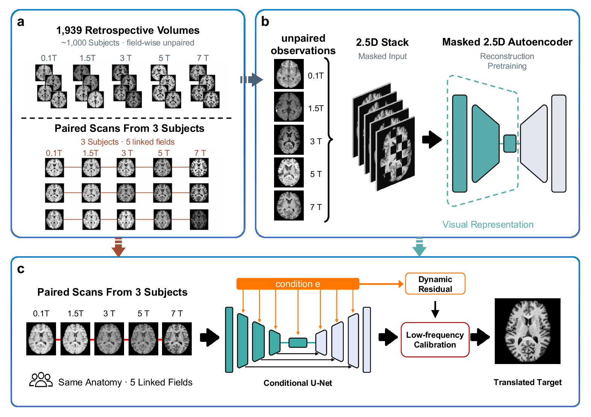

<h1 align="center">PAST-MRI</h1>
<p align="center">
  <strong>Rethinking Unpaired Data in Unified Cross-Field MRI Synthesis</strong><br>
  MICCAI 2026 · MRIxFields Challenge
</p>
<p align="center">
  <a href="https://papers.miccai.org/miccai-2026-sat/MRIxFields2026_005.html">Paper</a> ·
  <a href="https://papers.miccai.org/miccai-2026-sat/paper/MRIxFields2026_005.pdf">PDF</a> ·
  <a href="#validation-results">Results</a> ·
  <a href="#installation">Installation</a> ·
  <a href="#end-to-end-run">Run the pipeline</a> ·
  <a href="#citation">BibTeX</a>
</p>

> **Task 1 · Tied 10th of 24 teams** in the MRIxFields2026 challenge for
> synthesis to 7 T. [Official final ranking](https://www.synapse.org/Synapse:syn72060672/wiki/643814)

## Method

PAST-MRI (**P**retraining on unpaired **A**natomy followed by paired **S**upervised
**T**ranslation) first learns anatomy from 1,939 unpaired MRI volumes. Scans from
three volunteers imaged at all five field strengths then teach the same model to
translate across all 20 directed field pairs.



1. **Unpaired anatomical pretraining.** Five adjacent slices receive
   independent Gaussian noise and a shared 16-by-16 block mask. A conditional
   NAF U-Net reconstructs the clean center slice.
2. **Selective transfer.** Only the stem, encoders, downsampling layers, and
   bottleneck are transferred. Translation conditioning, decoder, calibration,
   hyper-residual, and output heads are initialized for the paired task.
3. **Paired translation.** A width-128 `CondNAFUNet5x5` predicts five target
   slices. Training balances all directed field pairs and uses three paired
   subjects, 40,000 steps, and EMA 0.9999.
4. **Overlap fusion.** At inference, overlapping five-slice predictions are
   uniformly fused into the output volume.

The Stage 1 objective is MDAE-inspired but is a task-specific 2.5D adaptation,
not an exact implementation of the original 3D method.

## Validation results

Table 2 of the paper reports external validation on 15 subjects using one
checkpoint across all three tasks.

| Task | Translation | SSIM ↑ | nRMSE ↓ | LPIPS ↓ |
|:---|:---|---:|---:|---:|
| 1 | Synthesis to 7 T | 0.9171 | 0.2858 | 0.0920 |
| 2 | Enhancement from 0.1 T | 0.8973 | 0.1941 | 0.1300 |
| 3 | All 20 directed field pairs | 0.9151 | 0.2223 | 0.0979 |

[Model card](MODEL_CARD.md) · [Full evaluation in the paper](https://papers.miccai.org/miccai-2026-sat/paper/MRIxFields2026_005.pdf)

<details>
<summary><strong>Repository layout and release manifest</strong></summary>

```text
configs/                  final Stage 1 and Stage 2 recipes
past_mri/data/            unpaired and paired datasets
past_mri/models/          conditional NAF U-Net and five-output model
past_mri/prepare_data.py  cache, split, manifest, and calibration preparation
past_mri/train_stage1.py  masked-denoising pretraining
past_mri/train_stage2.py  paired translation
past_mri/infer.py         multi-field inference and overlap fusion
scripts/run_pipeline.sh   end-to-end entry point
scripts/package_submission.py
scripts/verify_checkpoint.py
scripts/verify_submission.py
tests/                    focused regression tests
```

The exact release compatibility checks and source hashes are recorded in
[`RELEASE_MANIFEST.md`](RELEASE_MANIFEST.md).

</details>

## Installation

Python 3.10 or newer and a CUDA-capable PyTorch installation are recommended.

```bash
python -m venv .venv
source .venv/bin/activate
pip install -e ".[test]"
pytest -q
```

## Data Layout

The data-preparation command expects two roots:

```text
Training_retrospective/
  T1W|T2W|T2FLAIR/
    0.1T|1.5T|3T|5T|7T/
      R_<contrast>_<field>_<subject>.nii.gz

Training_prospective/
  T1W|T2W|T2FLAIR/
    0.1T|1.5T|3T|5T|7T/
      P_<contrast>_<field>_<subject>.nii.gz
```

Inputs are expected to be registered, normalized to `[0,1]`, and aligned
across fields for each paired subject. The preparation code clips non-finite
or out-of-range values and creates server-local NumPy slab caches.

## End-to-End Run

All large outputs should be placed on a local high-throughput disk.

```bash
export UNPAIRED_ROOT=/path/to/Training_retrospective
export PAIRED_ROOT=/path/to/Training_prospective
export VALIDATION_ROOT=/path/to/Validating_prospective
export DATA_ROOT=/local/disk/past_mri/data
export PAST_MRI_DATA_ROOT="$DATA_ROOT"
export OUTPUT_ROOT=/local/disk/past_mri/outputs
export GPU_ID=0

bash scripts/run_pipeline.sh prepare
bash scripts/run_pipeline.sh stage1
bash scripts/run_pipeline.sh stage2
bash scripts/run_pipeline.sh infer
bash scripts/run_pipeline.sh package
```

`bash scripts/run_pipeline.sh all` executes the complete sequence. Interrupted
Stage 1 and Stage 2 runs resume from `last.ckpt`; terminal 40k runs are
detected and not restarted.

### Stage 1

```bash
python -m past_mri.train_stage1 \
  --config configs/stage1_pretrain.yaml \
  --train-manifest "$DATA_ROOT/manifests/stage1_train.jsonl" \
  --val-manifest "$DATA_ROOT/manifests/stage1_val.jsonl" \
  --work-dir "$OUTPUT_ROOT/stage1" \
  --device cuda
```

The primary transfer artifact is:

```text
outputs/stage1/terminal_encoder_middle_core_initializer.ckpt
```

Verify that a resumable Stage 1 checkpoint exactly matches the public model:

```bash
python -m scripts.verify_checkpoint \
  --stage stage1 \
  --config configs/stage1_pretrain.yaml \
  --checkpoint "$OUTPUT_ROOT/stage1/last.ckpt"
```

### Stage 2

```bash
python -m past_mri.train_stage2 \
  --config configs/stage2_translation.yaml \
  --manifest "$DATA_ROOT/manifests/stage2_train.jsonl" \
  --work-dir "$OUTPUT_ROOT/stage2" \
  --init-model "$OUTPUT_ROOT/stage1/terminal_encoder_middle_core_initializer.ckpt" \
  --init-model-partial \
  --max-steps 40000 \
  --device cuda
```

Use `last.ckpt` for continuation and `ema_step_040000.ckpt` for inference.

## Checkpoint Verification

Weights are not stored in this code-only repository. After obtaining an
initializer or trained checkpoint:

```bash
python -m scripts.verify_checkpoint \
  --stage stage2 \
  --config configs/stage2_translation.yaml \
  --initializer /path/to/terminal_encoder_middle_core_initializer.ckpt \
  --checkpoint /path/to/ema_step_040000.ckpt
```

The final model must report 145,546,501 parameters, 264 transferred
initializer keys, zero shape mismatches, and a strict EMA load.

## Reproducibility

- Stage 1 full checkpoints store model, optimizer, scheduler, scaler, RNG,
  config, and manifest hashes. Its sample stream is step-token deterministic.
- Stage 2 full checkpoints store model, EMA, optimizer, scaler, global RNG,
  dataset RNG, and the resolved config.
- Configuration and manifest snapshots are written into each run directory.
- Example manifest rows are provided in `examples/`.

## License

MIT. See `LICENSE`.

## Citation

Please cite the PAST-MRI paper and the MRIxFields benchmark when using this code.

```bibtex
@inproceedings{WanMen_Rethinking_MICCAISAT2026,
  author    = {Wang, Mengfei and Li, Yunyi and Zeng, Yao and Li, Zhuo and
               Tu, Yifan and Tang, Yixiao and Cao, Zhongzheng and Zheng, Wenhua and
               Li, Yuehua and Zhang, Ruipeng},
  title     = {Rethinking Unpaired Data in Unified Cross-Field {MRI} Synthesis},
  booktitle = {Medical Image Computing and Computer Assisted Intervention -- MICCAI 2026 Workshops and Challenges},
  series    = {Lecture Notes in Computer Science},
  volume    = {17274},
  year      = {2026},
  publisher = {Springer Nature Switzerland},
  url       = {https://papers.miccai.org/miccai-2026-sat/MRIxFields2026_005.html}
}
```
